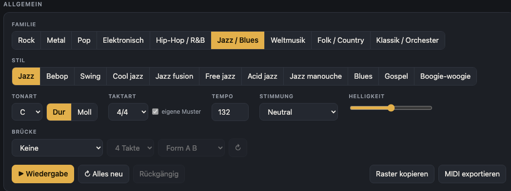
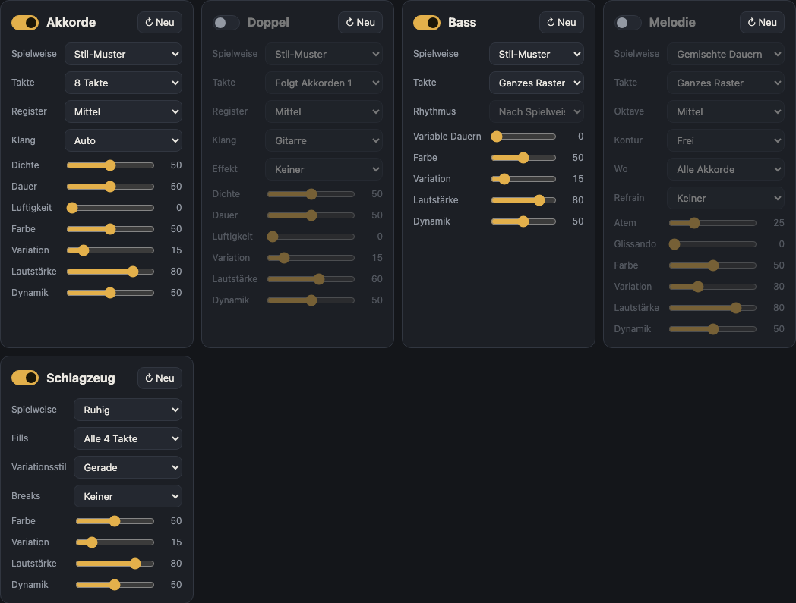
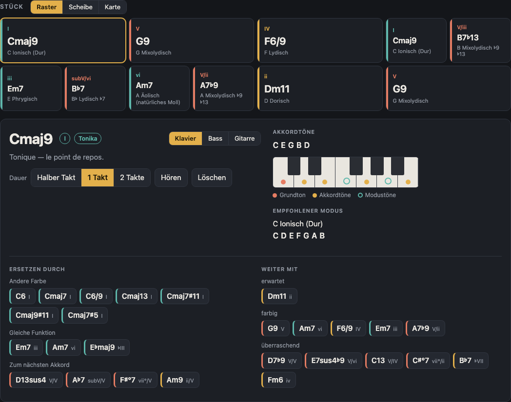
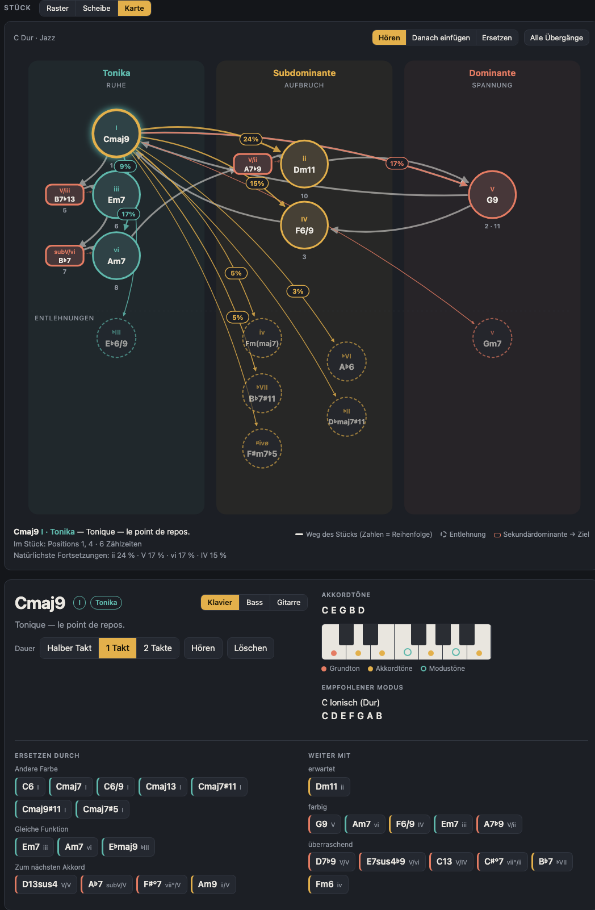
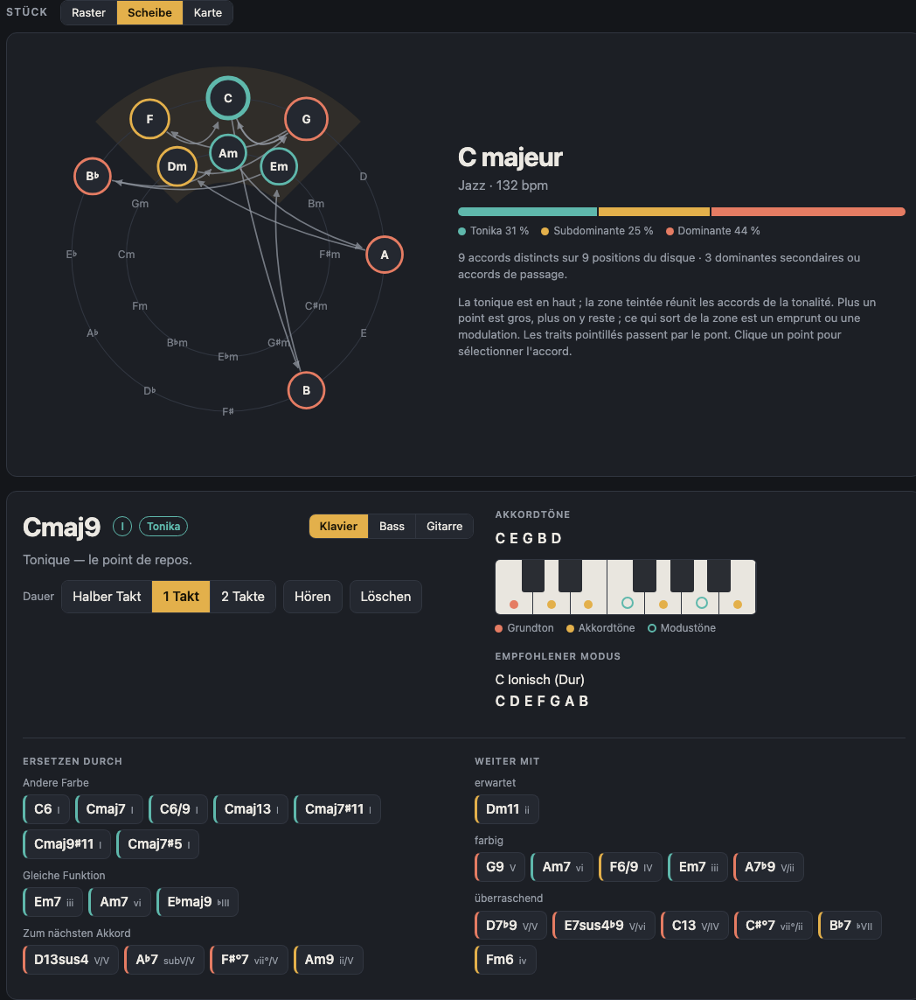
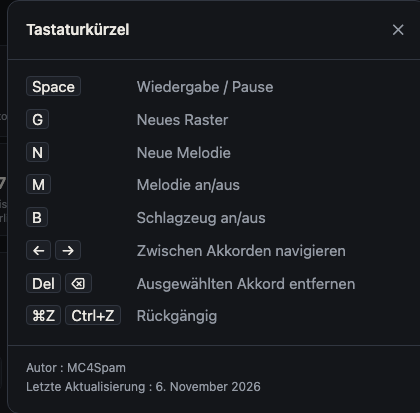
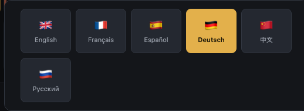

# Harmonie: Benutzerhandbuch

Harmonie erzeugt Akkordfolgen und Modi mit Bass, Melodie und Schlagzeug, zum Komponieren in vielen Stilen. Alles läuft im Browser, ohne Installation.

Um die Anwendung zu starten, öffnen Sie `index.html` in Ihrem Browser oder stellen Sie den Projektordner bereit (zum Beispiel `python3 -m http.server 8080`) und öffnen Sie `http://localhost:8080`.

Einstellungen und das aktuelle Raster werden im Browser jedes Rechners gespeichert.

## Übersicht

Der Bildschirm besteht aus drei Bereichen:

1. **Allgemein**: die Einstellungen, die das Stück bestimmen (Familie, Stil, Tonart, Takt, Tempo, Stimmung, Helligkeit, Brücke), und die Transportknöpfe.
2. **Instrumente**: ein Feld pro Stimme (Akkorde, Doppel, Bass, Melodie, Schlagzeug).
3. **Stück**: das Akkordraster mit den Ansichten Raster, Scheibe und Karte.

Oben rechts öffnet die Schaltfläche „i“ die Tastenkürzel, die Flagge die Sprachauswahl. Mit dem Umschalter **Klassisch / Studio** ändern Sie das Erscheinungsbild; „Klassisch“ ist voreingestellt.

## Bereich Allgemein

| Einstellung | Funktion |
|---|---|
| **Familie** | Gruppiert die Stile in große Familien (Rock, Metal, Pop, Elektronisch, Hip-Hop / R&B, Jazz / Blues, Weltmusik, Folk / Country, Klassik / Orchester). |
| **Stil** | Wählt den Stil innerhalb der Familie. Jeder Stil hat eigenes harmonisches Vokabular, ein Begleitmuster und ein Schlagzeug. Die Wahl eines Stils erzeugt ein neues Raster. |
| **Tonart** | Der Grundton (C bis B, mit b und #), dazu die Knöpfe **Dur** und **Moll**. Eine Änderung der Tonart transponiert das Raster, ohne es neu zu erzeugen. |
| **Takt** | Die rhythmische Signatur. Das Kästchen **eigene Muster** verwendet, wenn vorhanden, ein eigenes Rhythmusmuster für den Takt statt der Verteilung des 4/4-Musters. |
| **Tempo** | Tempo in Schlägen pro Minute (50 bis 220). |
| **Stimmung** | Eine Voreinstellung (standardmäßig Neutral, danach fröhlich, melancholisch, episch usw.). Sie setzt Modus, Tempo, Helligkeit und Instrumenteinstellungen und erzeugt ein neues Raster. Alle diese Einstellungen bleiben veränderbar. |
| **Helligkeit** | Regler, der Harmonie und Klang heller oder dunkler macht. |
| **Brücke** | Fügt einen kontrastierenden Abschnitt in einer benachbarten Tonart hinzu: keine, Halbton oder Ganzton höher, kleine Terz höher, Parallele Moll, Variante Moll, Subdominant- oder Dominant-Tonart. Optionen: Länge (4 oder 8 Takte) und Form (**A B** oder **A A B A**). Der Knopf ↻ erzeugt nur die Brücke neu. |

Die Transportknöpfe befinden sich unten in diesem Bereich:

- **Wiedergabe** startet oder stoppt die Wiedergabe (Tastenkürzel: Leertaste).
- **Alles neu** erzeugt ein neues Raster und eine neue Stimme für jedes Instrument.
- **Rückgängig** macht den letzten Schritt rückgängig (⌘Z oder Strg+Z).
- **Raster kopieren** legt das Raster als Text in die Zwischenablage.
- **MIDI exportieren** lädt eine MIDI-Datei des Gehörten herunter (siehe unten).

## Instrumente

Jedes Instrument hat sein eigenes Feld. Alle teilen dieselben Grundeinstellungen: **↻ Neu** (erzeugt nur diese Stimme neu), **Dichte** oder **Farbe**, **Variation** (wie stark sich die Stimme von Wiederholung zu Wiederholung ändert), **Lautstärke** und **Dynamik**. Fahren Sie mit der Maus über eine Einstellung, um ihre Wirkung zu sehen.

### Akkorde

Das Feld Akkorde spielt das Raster selbst.

- **Spielweise**: Wie die Akkorde gespielt werden: geschlagen, Arpeggio aufwärts, Arpeggio abwärts, Arpeggio auf-ab, Zufalls-Arpeggio oder Stil-Muster.
- **Takte**: Länge des Musters (4, 8, 12 oder 16 Takte).
- **Register**: tief, mittel oder hoch.
- **Klang**: Auto, Klavier, Gitarre, Pad, Gezupft, Orgel, Verzerrt, Blechbläser oder Synth.
- **Dichte**, **Dauer**, **Luftigkeit**: Anzahl der Noten, Notenlänge und Pausen zwischen ihnen.

### Doppel

Das zweite Instrument verdoppelt die Akkorde, mit eigenem Klang und eigenem Effekt.

- **Folgt Akkorden**: legt fest, welche Takte verdoppelt werden. Die Einstellungen entsprechen denen von Akkorde, zusätzlich mit **Effekt**: Keiner, Sättigung, Tremolo oder Fuzz.
- Die Standardlautstärke liegt unter der der Akkorde.

### Bass

Der Bass trennt die **Wahl der Noten** (Spielweise) vom **Zeitpunkt, an dem sie erklingen** (Rhythmus).

- **Spielweise**: Stil-Muster, Grundton, Grundton und Quinte, Grundton und Oktave, Arpeggio, Walking Bass, Orgelpunkt, Riff, Singende Linie oder Zufall.
- **Rhythmus**: Nach Spielweise, Ganze, Halbe, Viertel, Achtel, Triolen, Sechzehntel, Synkopiert (3+3+2), Pump (Zählzeit 1 und 3), Vorgezogen, Mit Ghost-Notes, An der Bassdrum oder Variable Dauern.
- **Takte**: ganzes Raster oder ein Motiv aus 1, 2, 4 oder 8 Takten.

### Melodie

Die Melodie lässt sich mit der Taste M stummschalten oder wieder aktivieren.

- **Spielweise**: Lange Noten, Gemischte Dauern oder Lebhafte Noten.
- **Takte**: ganzes Raster oder ein Motiv aus 1, 2, 4 oder 8 Takten. **↻ Neu** erzeugt eine neue Melodie (Taste N).
- **Oktave**: von sehr tief (−2) bis sehr hoch (+2).
- **Kontur**: frei, aufsteigend oder absteigend.
- **Wo**: alle Akkorde, ungerade Akkorde, gerade Akkorde oder nur auf der Tonika.
- **Refrain**: wiederholt dasselbe Motiv alle 2, 4 oder 8 Takte.
- **Atem**: Pausen zwischen den Phrasen. **Glissando**: Verbindungen zwischen den Noten.

### Schlagzeug

Das Schlagzeug lässt sich mit der Taste B stummschalten oder wieder aktivieren.

- **Spielweise**: Gedämpft, Ruhig oder Energisch.
- **Fills**: kein Fill, oder ein Fill alle 2, 4, 8 oder 16 Takte.
- **Variationsstil**: Gerade, Ghost-Notes, Synkopen, Laid-back oder Dicht.
- **Breaks**: keiner, oder ein Break alle 4, 8 oder 16 Takte.

## Akkordraster

Jeder Akkord erscheint als Karte mit Symbol, Stufe in der Tonart, Funktion und empfohlenem Modus. Ein Klick auf einen Akkord öffnet seine Details unter dem Raster:

- **Dauer**: halber Takt, 1 Takt oder 2 Takte.
- **Hören** spielt nur diesen Akkord. **Löschen** entfernt den Akkord.
- **Akkordtöne**: Grundton, Akkordtöne und Modustöne, in einer Ansicht für Klavier, Bass oder Gitarre. Für Bass und Gitarre werden Griffe angezeigt.
- **Empfohlener Modus**: der Modus, der zum Akkord passt.
- **Ersetzen durch**: schlägt Akkorde mit gleicher Funktion vor (andere Farbe, gleiche Funktion, Akkord, der zum nächsten führt), sortiert nach Wirkung.
- **Fortsetzen mit**: schlägt mögliche Folgeakkorde vor, von „erwartet“ bis „überraschend“.

Mit den Pfeiltasten ← und → wechseln Sie zum vorherigen bzw. nächsten Akkord, mit Entf entfernen Sie den ausgewählten Akkord.

## Ansichten Karte und Scheibe

Die **Karte** ordnet jeden Akkord nach seiner harmonischen Funktion an: Tonika, Subdominante, Dominante usw. So sehen Sie auf einen Blick, wo die Folge steht.

Die **Scheibe** zeigt die Akkorde auf dem Quintenzirkel, wodurch Nachbarakkorde und Dominanten sichtbar werden.

Die Schaltflächen **Raster**, **Scheibe** oder **Karte** über dem Stück wechseln die Ansicht. Alle drei Ansichten zeigen dasselbe Stück.

## MIDI-Export und Kopieren

**MIDI exportieren** erstellt eine MIDI-Datei, die genau dem entspricht, was Sie hören:

- eine Spur pro Instrument (Akkorde, Doppel, Bass, Melodie);
- das Schlagzeug auf Kanal 10;
- Tempo, Takt und eine Markierung für jeden Akkord.

**Raster kopieren** legt das Raster als Text in die Zwischenablage, zum Einfügen in eine Notiz oder Nachricht.

## Tastenkürzel

| Taste | Aktion |
|---|---|
| Leertaste | Wiedergabe / Stopp |
| G | neues Raster |
| N | neue Melodie |
| M | Melodie an / aus |
| B | Schlagzeug an / aus |
| ← → | vorheriger / nächster Akkord |
| Entf oder ⌫ | ausgewählten Akkord entfernen |
| ⌘Z / Strg+Z | rückgängig |

## Sprache

Die Flagge oben rechts öffnet die Sprachauswahl. Harmonie ist in sechs Sprachen verfügbar: English, Français, Español, Deutsch, 中文 und Русский. Die Auswahl wird im Browser gespeichert.
