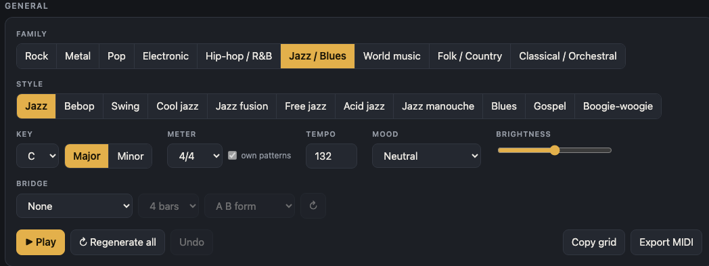
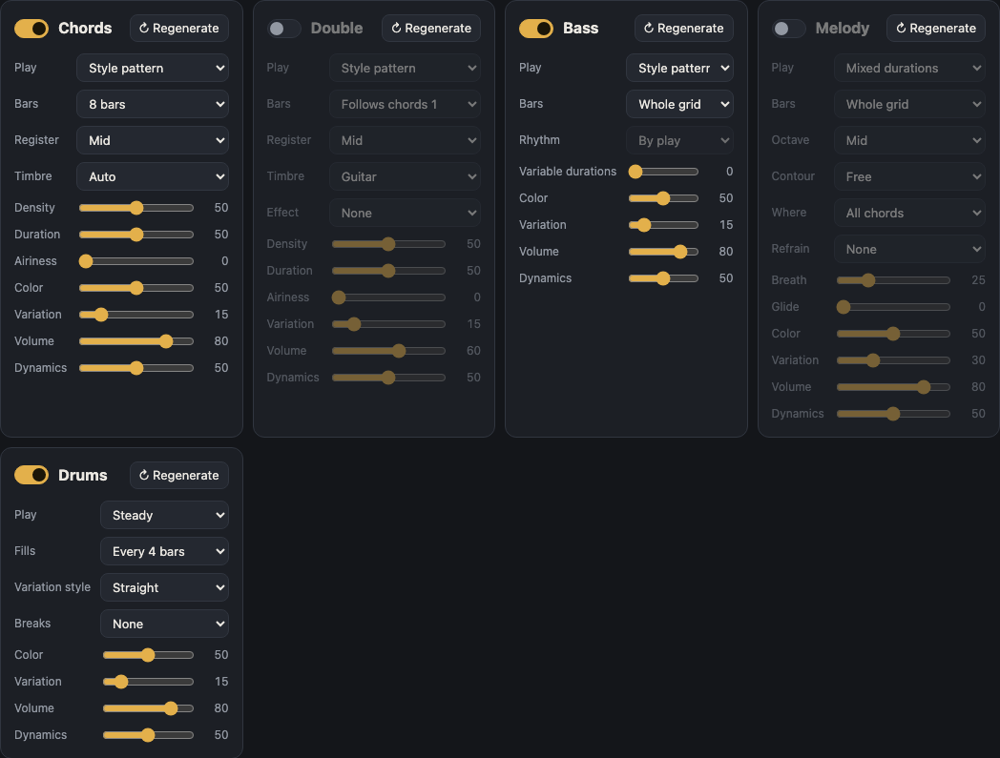
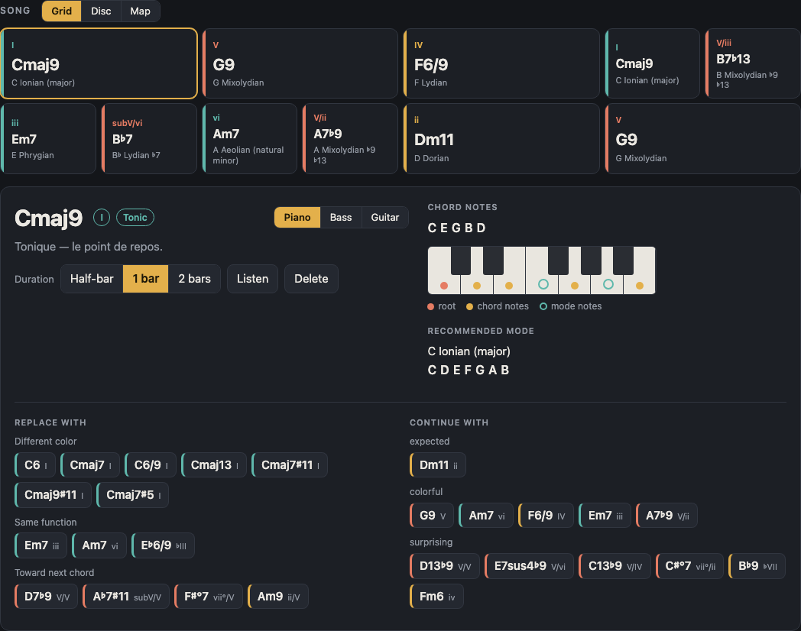
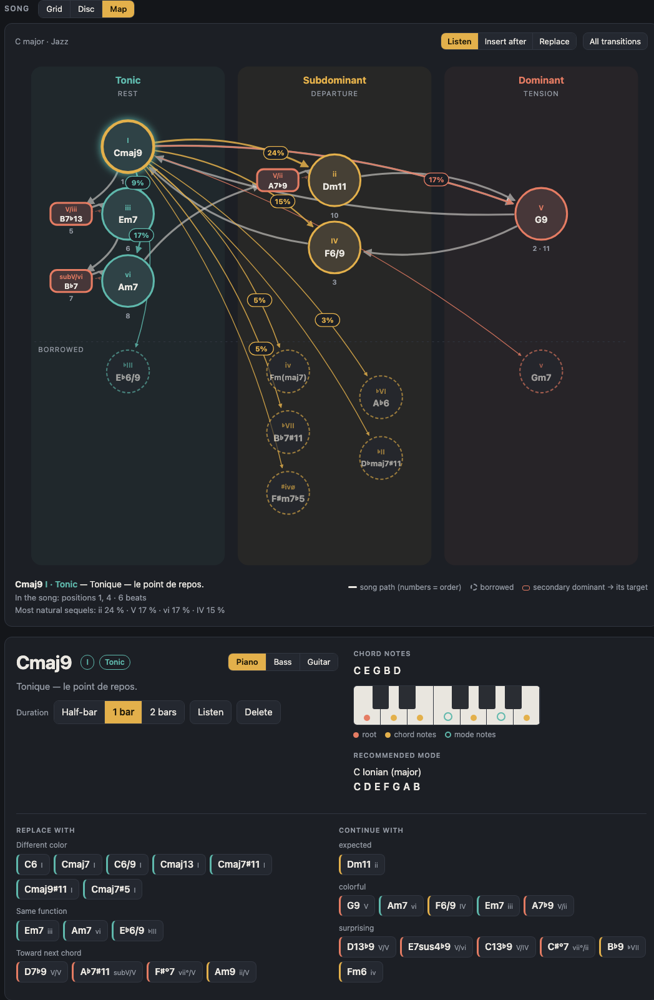
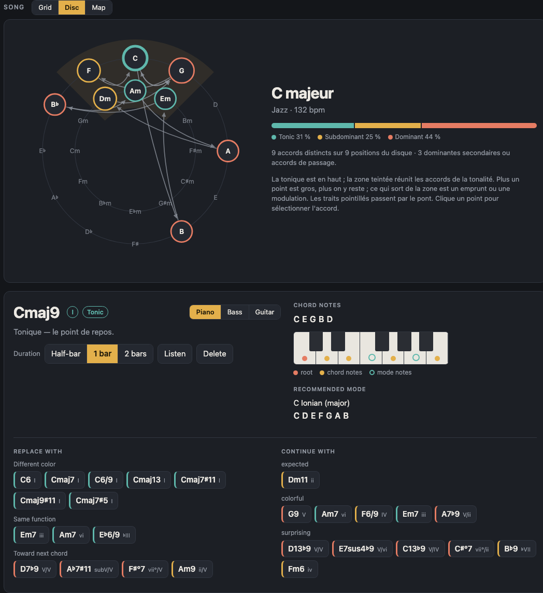
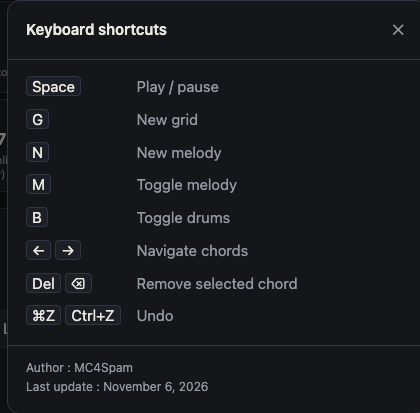
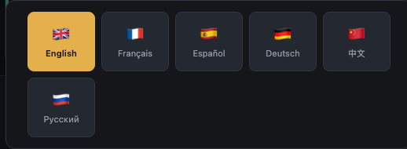

# Harmonie: user guide

Harmonie generates chord progressions and modes, with a bass, a melody and drums, for composing in many styles. Everything runs in the browser, with no installation.

To launch the application, open `index.html` in your browser, or serve the project folder (for example `python3 -m http.server 8080`) and open `http://localhost:8080`.

Settings and the current grid are remembered in the browser of each machine.

## Overview

The screen has three parts:

1. **General**: the settings that shape the piece (family, style, key, meter, tempo, mood, brightness, bridge) and the transport buttons.
2. **Instruments**: one panel per part (Chords, Double, Bass, Melody, Drums).
3. **Song**: the chord grid, with the Grid, Disc and Map views.

At the top right, the "i" button opens the keyboard shortcuts, and the flag opens the language choice. The **Classic / Studio** selector changes the look; "Classic" is the default.

## General zone

| Setting | Role |
|---|---|
| **Family** | Groups styles into large families (Rock, Metal, Pop, Electronic, Hip-hop / R&B, Jazz / Blues, World music, Folk / Country, Classical / Orchestral). |
| **Style** | Chooses the style within the family. Each style has its own harmonic vocabulary, accompaniment pattern and drum kit. Choosing a style generates a new grid. |
| **Key** | The reference note (C to B, flats and sharps included), with the **Major** and **Minor** buttons. Changing the key transposes the grid without regenerating it. |
| **Meter** | The rhythmic signature. The **own patterns** checkbox uses a rhythm pattern specific to the meter, when one exists, instead of redistributing the 4/4 pattern. |
| **Tempo** | Tempo in beats per minute (50 to 220). |
| **Mood** | A preset (Neutral by default, then joyful, melancholic, epic, and so on). It sets the mode, tempo, brightness and instrument settings, then generates a new grid. All of these settings remain editable. |
| **Brightness** | Slider that makes the harmony and sound brighter or darker. |
| **Bridge** | Adds a contrasting section in a neighbouring key: none, half-tone or whole-tone above, minor third above, relative minor, parallel minor, subdominant key or dominant key. Options: length (4 or 8 bars) and form (**A B** or **A A B A**). The ↻ button regenerates the bridge alone. |

The transport buttons are at the bottom of this zone:

- **Play** starts or stops playback (shortcut: Space).
- **Regenerate all** creates a new grid and a new part for each instrument.
- **Undo** goes back one step (⌘Z or Ctrl+Z).
- **Copy grid** puts the grid on the clipboard as text.
- **Export MIDI** downloads a MIDI file of what you hear (see below).

## Instruments

Each instrument has its own panel. All of them share the same basic settings: **↻ Regenerate** (recreates only that part), **Density** or **Color**, **Variation** (how much the part changes from one repetition to the next), **Volume** and **Dynamics**. Hover over a setting to see what it does.

### Chords

The Chords panel plays the grid itself.

- **Play**: how the chords are played: block chords, ascending arpeggio, descending arpeggio, up-down arpeggio, random arpeggio, or style pattern.
- **Bars**: length of the pattern (4, 8, 12 or 16 bars).
- **Register**: low, mid or high.
- **Timbre**: Auto, Piano, Guitar, Pad, Pluck, Organ, Distorted, Brass or Synth.
- **Density**, **Duration**, **Airiness**: number of notes played, note length and silence between them.

### Double

The second instrument doubles the chords, with its own timbre and effect.

- **Follows chords**: sets which bars are doubled. Its settings are the same as for Chords, with the addition of **Effect**: None, Saturation, Tremolo or Fuzz.
- Its default volume is lower than that of the chords.

### Bass

The bass separates the **choice of notes** (Play) from the **timing of notes** (Rhythm).

- **Play**: Style pattern, Root, Root and fifth, Root and octave, Arpeggio, Walking bass, Pedal, Riff, Singing line or Random.
- **Rhythm**: By play, whole notes, half notes, quarter notes, eighth notes, triplets, sixteenth notes, syncopated (3+3+2), pump (beats 1 and 3), anticipated, with ghost notes, on the kick drum, or variable durations.
- **Bars**: whole grid, or a 1-, 2-, 4- or 8-bar motif.

### Melody

The melody can be muted or unmuted with the M key.

- **Play**: Long notes, Mixed durations or Fast notes.
- **Bars**: whole grid, or a 1-, 2-, 4- or 8-bar motif. **↻ Regenerate** creates a new melody (N key).
- **Octave**: from very low (−2) to very high (+2).
- **Contour**: free, ascending or descending.
- **Where**: all chords, odd chords, even chords, or tonic only.
- **Refrain**: repeats the same motif every 2, 4 or 8 bars.
- **Breath**: silences between phrases. **Glissando**: slides between notes.

### Drums

The drums can be muted or unmuted with the B key.

- **Play**: Soft, Steady or Energetic.
- **Fills**: no fill, or a fill every 2, 4, 8 or 16 bars.
- **Variation style**: Straight, Ghost notes, Syncopation, Laid-back or Busy.
- **Breaks**: none, or a break every 4, 8 or 16 bars.

## Chord grid

Each chord appears as a card with its symbol, its degree in the key, its function and the recommended mode. Clicking a chord opens its details below the grid:

- **Duration**: half bar, 1 bar or 2 bars.
- **Listen** plays this chord alone. **Delete** removes the chord.
- **Chord notes**: the root, the chord notes and the mode notes, in a piano, bass or guitar view. Fingerings are shown for bass and guitar.
- **Recommended mode**: the mode that fits the chord.
- **Replace with**: suggests chords with the same function (different colour, same function, leading to the next chord), sorted by effect.
- **Continue with**: suggests possible next chords, from "expected" to "surprising".

The ← and → arrows move from one chord to the next, and Del removes the selected chord.

## Map and Disc views

The **Map** places each chord according to its harmonic function: tonic, subdominant, dominant, and so on. It shows at a glance where the progression sits.

The **Disc** shows the chords on the circle of fifths, which makes neighbouring chords and dominants visible.

The **Grid**, **Disc** or **Map** button above the song switches views. All three show the same piece.

## MIDI export and copy

**Export MIDI** produces a MIDI file that matches exactly what you hear:

- one track per instrument (chords, double, bass, melody);
- drums on channel 10;
- the tempo, the meter and a marker for each chord.

**Copy grid** puts the grid on the clipboard as text, so you can paste it into a note or a message.

## Keyboard shortcuts

| Key | Action |
|---|---|
| Space | play / stop |
| G | new grid |
| N | new melody |
| M | melody on / off |
| B | drums on / off |
| ← → | previous / next chord |
| Del or ⌫ | remove the selected chord |
| ⌘Z / Ctrl+Z | undo |

## Language

The flag at the top right opens the language choice. Harmonie is available in six languages: English, Français, Español, Deutsch, 中文 and Русский. The choice is remembered in the browser.
