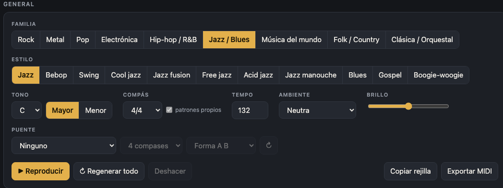
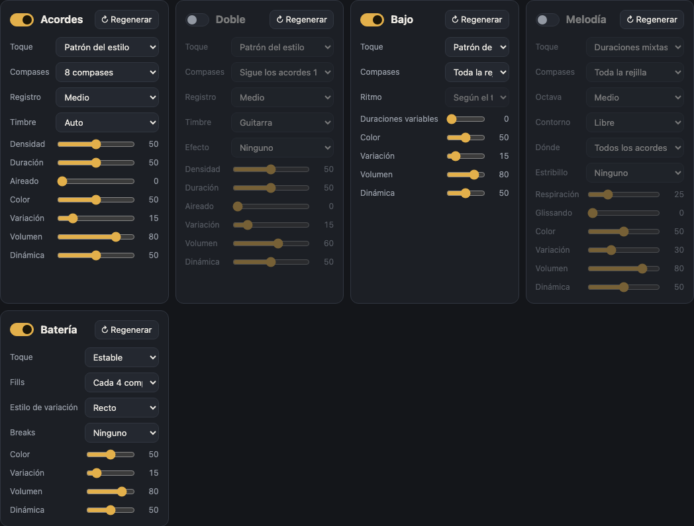
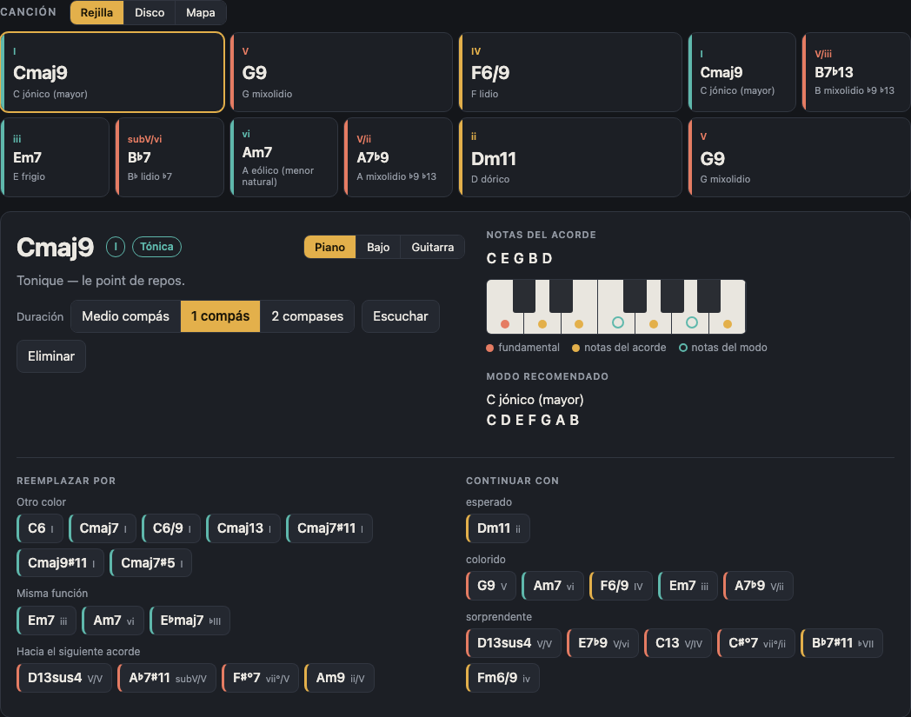
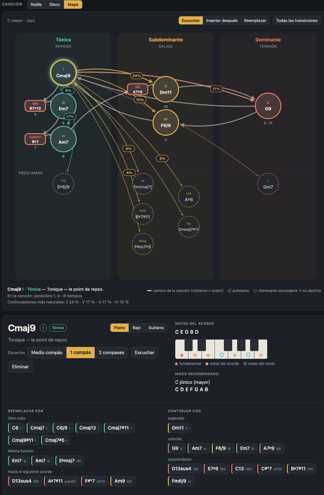
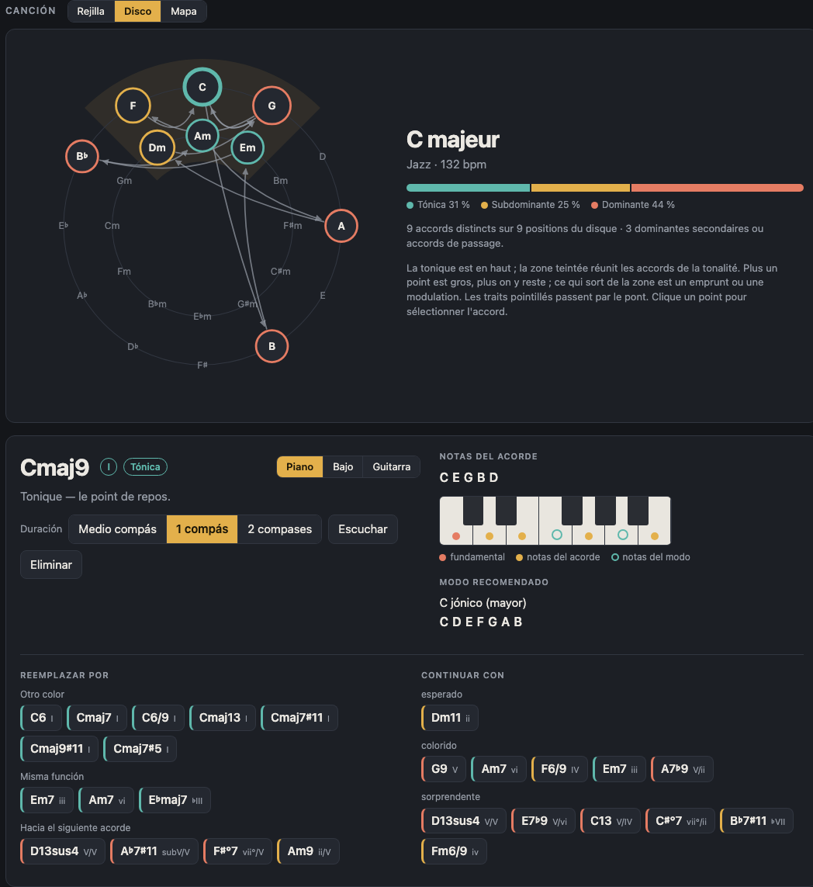
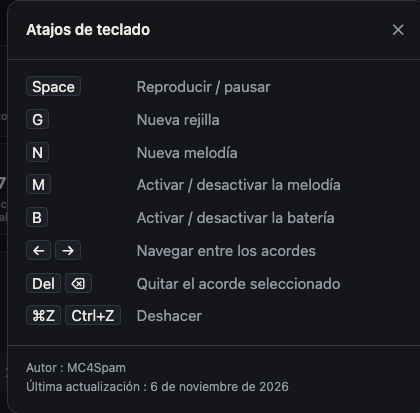
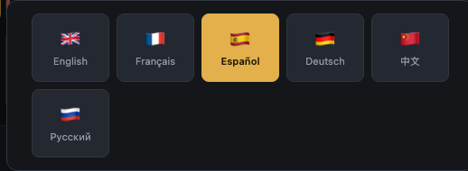

# Harmonie: guía de uso

Harmonie genera progresiones de acordes y modos, con bajo, melodía y batería, para componer en muchos estilos. Todo funciona en el navegador, sin instalación.

Para abrir la aplicación, abra `index.html` en su navegador, o sirva la carpeta del proyecto (por ejemplo `python3 -m http.server 8080`) y abra `http://localhost:8080`.

Los ajustes y la rejilla actual se guardan en el navegador de cada equipo.

## Vista general

La pantalla tiene tres partes:

1. **General**: los ajustes que definen la pieza (familia, estilo, tono, compás, tempo, ambiente, brillo, puente) y los botones de transporte.
2. **Instrumentos**: un panel por parte (Acordes, Doble, Bajo, Melodía, Batería).
3. **Canción**: la rejilla de acordes, con las vistas Rejilla, Disco y Mapa.

Arriba a la derecha, el botón «i» abre los atajos de teclado, y la bandera abre la elección de idioma. El selector **Clásico / Estudio** cambia el aspecto; «Clásico» es el predeterminado.

## Zona General

| Ajuste | Función |
|---|---|
| **Familia** | Agrupa los estilos en grandes familias (Rock, Metal, Pop, Electrónica, Hip-hop / R&B, Jazz / Blues, Música del mundo, Folk / Country, Clásica / Orquestal). |
| **Estilo** | Elige el estilo dentro de la familia. Cada estilo tiene su vocabulario armónico, su patrón de acompañamiento y su batería. Elegir un estilo genera una rejilla nueva. |
| **Tono** | La nota de referencia (de Do a Si, con bemoles y sostenidos), con los botones **Mayor** y **Menor**. Cambiar de tono transpone la rejilla sin regenerarla. |
| **Compás** | La signatura rítmica. La casilla **patrones propios** usa, cuando existe, un patrón rítmico propio del compás en lugar de redistribuir el patrón de 4/4. |
| **Tempo** | Tempo en pulsos por minuto (de 50 a 220). |
| **Ambiente** | Un preajuste (Neutra por defecto, después alegre, melancólica, épica, etc.). Fija el modo, el tempo, el brillo y los ajustes de los instrumentos, y genera una rejilla nueva. Todos estos ajustes siguen siendo modificables. |
| **Brillo** | Deslizador que hace la armonía y el sonido más luminosos u oscuros. |
| **Puente** | Añade una sección contrastante en un tono vecino: ninguno, semitono o tono arriba, tercera menor arriba, relativo menor, homónimo menor, tono de la subdominante o de la dominante. Opciones: longitud (4 u 8 compases) y forma (**A B** o **A A B A**). El botón ↻ regenera solo el puente. |

Los botones de transporte están al pie de esta zona:

- **Reproducir** inicia o detiene la reproducción (atajo: Espacio).
- **Regenerar todo** crea una rejilla nueva y una parte nueva para cada instrumento.
- **Deshacer** vuelve atrás (⌘Z o Ctrl+Z).
- **Copiar rejilla** copia la rejilla en texto al portapapeles.
- **Exportar MIDI** descarga un archivo MIDI de lo que se escucha (ver más abajo).

## Instrumentos

Cada instrumento tiene su panel. Todos comparten los mismos ajustes básicos: **↻ Regenerar** (recrea solo esa parte), **Densidad** o **Color**, **Variación** (cuánto cambia la parte de una repetición a otra), **Volumen** y **Dinámica**. Pase el ratón sobre un ajuste para ver lo que hace.

### Acordes

El panel Acordes toca la propia rejilla.

- **Toque**: la forma de tocar los acordes: en bloque, arpegio ascendente, arpegio descendente, arpegio ida y vuelta, arpegio aleatorio o patrón del estilo.
- **Compases**: longitud del patrón (4, 8, 12 o 16 compases).
- **Registro**: grave, medio o agudo.
- **Timbre**: Auto, Piano, Guitarra, Pad, Pulsado, Órgano, Distorsionado, Metales o Sinte.
- **Densidad**, **Duración**, **Aireado**: número de notas, duración de las notas y silencios entre ellas.

### Doble

El segundo instrumento dobla los acordes, con un timbre y un efecto propios.

- **Sigue los acordes**: indica qué compases se doblan. Sus ajustes son los mismos que los de Acordes, con además **Efecto**: Ninguno, Saturación, Trémolo o Fuzz.
- Su volumen predeterminado es menor que el de los acordes.

### Bajo

El bajo separa la **elección de las notas** (Toque) del **momento en que suenan** (Ritmo).

- **Toque**: Patrón del estilo, Fundamental, Fundamental y quinta, Fundamental y octava, Arpegio, Walking bass, Pedal, Riff, Línea cantabile o Aleatorio.
- **Ritmo**: Según el toque, redondas, blancas, negras, corcheas, tresillos, semicorcheas, sincopado (3+3+2), bombeo (tiempos 1 y 3), anticipado, con notas fantasma, en el bombo, o duraciones variables.
- **Compases**: toda la rejilla, o un motivo de 1, 2, 4 u 8 compases.

### Melodía

La melodía puede silenciarse o reactivarse con la tecla M.

- **Toque**: Notas largas, Duraciones mixtas o Notas rápidas.
- **Compases**: toda la rejilla, o un motivo de 1, 2, 4 u 8 compases. **↻ Regenerar** crea una melodía nueva (tecla N).
- **Octava**: de muy grave (−2) a muy agudo (+2).
- **Contorno**: libre, ascendente o descendente.
- **Dónde**: todos los acordes, acordes impares, acordes pares, o solo en la tónica.
- **Estribillo**: repite un mismo motivo cada 2, 4 u 8 compases.
- **Respiración**: silencios entre frases. **Glissando**: ligados entre notas.

### Batería

La batería puede silenciarse o reactivarse con la tecla B.

- **Toque**: Suave, Estable o Enérgica.
- **Fills**: sin fill, o un fill cada 2, 4, 8 o 16 compases.
- **Estilo de variación**: Recto, Notas fantasma, Síncopas, Relajado o Denso.
- **Breaks**: ninguno, o un break cada 4, 8 o 16 compases.

## Rejilla de acordes

Cada acorde aparece como una tarjeta con su símbolo, su grado en el tono, su función y el modo recomendado. Al hacer clic en un acorde, se abren sus detalles debajo de la rejilla:

- **Duración**: medio compás, 1 compás o 2 compases.
- **Escuchar** toca solo este acorde. **Eliminar** quita el acorde.
- **Notas del acorde**: la fundamental, las notas del acorde y las notas del modo, en vista de piano, bajo o guitarra. Para bajo y guitarra se muestran las digitaciones.
- **Modo recomendado**: el modo que encaja con el acorde.
- **Reemplazar por**: propone acordes con la misma función (otro color, misma función, acorde que lleva al siguiente), ordenados por efecto.
- **Continuar con**: propone posibles siguientes acordes, de «esperado» a «sorprendente».

Las flechas ← y → pasan de un acorde al siguiente, y Supr elimina el acorde seleccionado.

## Vistas Mapa y Disco

El **Mapa** coloca cada acorde según su función armónica: tónica, subdominante, dominante, etc. Permite ver de un vistazo dónde se sitúa la progresión.

El **Disco** muestra los acordes sobre el círculo de quintas, lo que hace visibles los acordes vecinos y las dominantes.

Los botones **Rejilla**, **Disco** o **Mapa** encima de la canción cambian de vista. Las tres vistas muestran la misma pieza.

## Exportación MIDI y copia

**Exportar MIDI** produce un archivo MIDI que coincide exactamente con lo que se escucha:

- una pista por instrumento (acordes, doble, bajo, melodía);
- la batería en el canal 10;
- el tempo, el compás y una marca para cada acorde.

**Copiar rejilla** copia la rejilla en texto al portapapeles, para pegarla en una nota o un mensaje.

## Atajos de teclado

| Tecla | Acción |
|---|---|
| Espacio | reproducir / detener |
| G | nueva rejilla |
| N | nueva melodía |
| M | melodía activada / silenciada |
| B | batería activada / silenciada |
| ← → | acorde anterior / siguiente |
| Supr o ⌫ | quitar el acorde seleccionado |
| ⌘Z / Ctrl+Z | deshacer |

## Idioma

La bandera arriba a la derecha abre la elección de idioma. Harmonie está disponible en seis idiomas: English, Français, Español, Deutsch, 中文 y Русский. La elección se guarda en el navegador.
