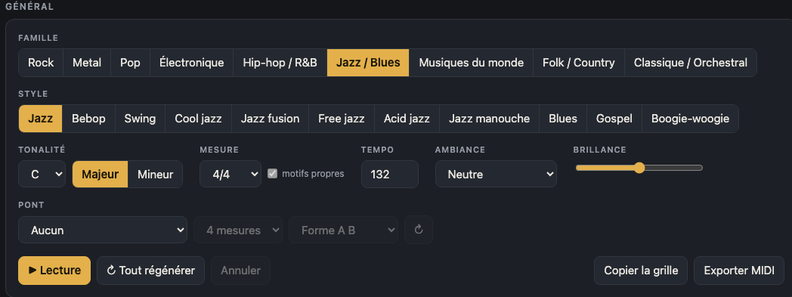
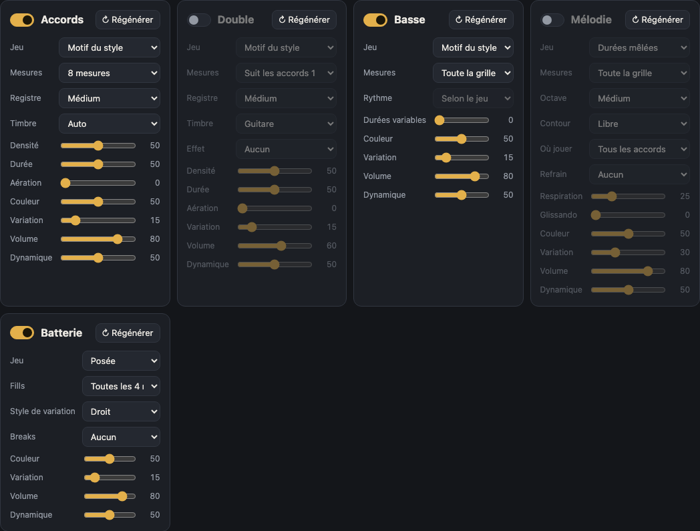
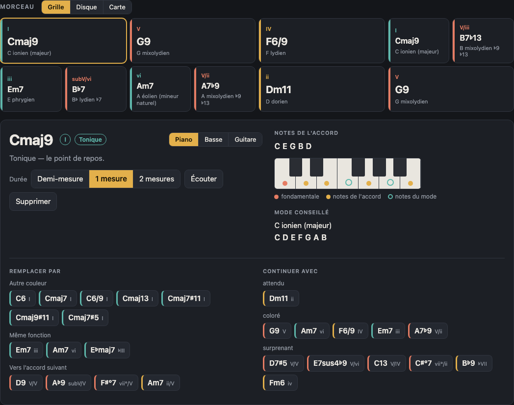
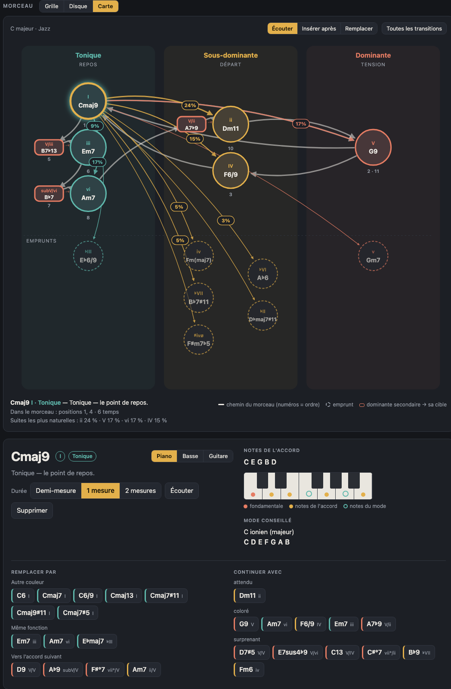
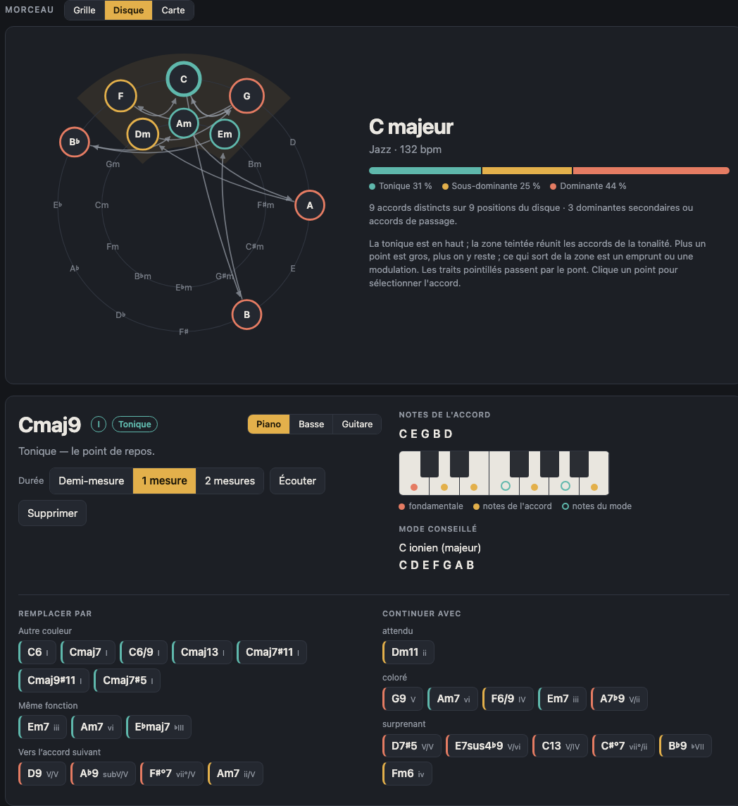
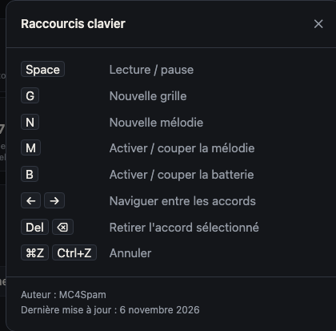
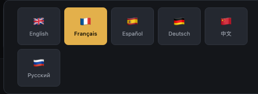

# Harmonie : guide d'utilisation

Harmonie génère des suites d'accords et des modes, avec une basse, une mélodie et une batterie, pour composer dans de nombreux styles. Tout tourne dans le navigateur, sans installation.

Pour lancer l'application, ouvrez `index.html` dans votre navigateur, ou servez le dossier du projet (par exemple `python3 -m http.server 8080`) puis ouvrez `http://localhost:8080`.

Les réglages et la grille en cours sont mémorisés dans le navigateur de chaque machine.

## Vue d'ensemble

L'écran se compose de trois parties :

1. **Général** : les réglages qui déterminent le morceau (famille, style, tonalité, mesure, tempo, ambiance, brillance, pont) et les boutons de transport.
2. **Instruments** : un panneau par partie (Accords, Double, Basse, Mélodie, Batterie).
3. **Morceau** : la grille d'accords, avec les vues Grille, Disque et Carte.

En haut à droite, le bouton « i » ouvre les raccourcis clavier, et le drapeau ouvre le choix de la langue. Le sélecteur **Classique / Studio** change l'habillage ; « Classique » est l'habillage par défaut.

## Zone Général

| Réglage | Rôle |
|---|---|
| **Famille** | Regroupe les styles par grande famille (Rock, Metal, Pop, Électronique, Hip-hop / R&B, Jazz / Blues, Musiques du monde, Folk / Country, Classique / Orchestral). |
| **Style** | Choisit le style à l'intérieur de la famille. Chaque style a son vocabulaire harmonique, son motif d'accompagnement et sa batterie. Choisir un style génère une nouvelle grille. |
| **Tonalité** | La note de référence (C à B, bémols et dièses inclus), avec les boutons **Majeur** et **Mineur**. Changer de tonalité transpose la grille sans la régénérer. |
| **Mesure** | La signature rythmique. La case **motifs propres** utilise, lorsqu'elle existe, un motif rythmique propre à la mesure au lieu de la redistribution du motif 4/4. |
| **Tempo** | Le tempo en battements par minute (50 à 220). |
| **Ambiance** | Un préréglage (Neutre par défaut, puis joyeuse, mélancolique, épique, etc.). Il pose le mode, le tempo, la brillance et les réglages des instruments, puis génère une nouvelle grille. Tous ces réglages restent modifiables. |
| **Brillance** | Curseur qui rend l'harmonie et le son plus ou moins lumineux. |
| **Pont** | Ajoute une section contrastante dans une tonalité voisine : aucun, demi-ton ou ton au-dessus, tierce mineure au-dessus, relatif mineur, homonyme mineur, tonalité de la sous-dominante ou de la dominante. Réglages : longueur (4 ou 8 mesures) et forme (**A B** ou **A A B A**). Le bouton ↻ régénère le pont seul. |

Les boutons de transport se trouvent en bas de cette zone :

- **Lecture** lance ou arrête la lecture (raccourci : Espace).
- **Tout régénérer** crée une nouvelle grille et une nouvelle partie pour chaque instrument.
- **Annuler** revient en arrière (⌘Z ou Ctrl+Z).
- **Copier la grille** place la grille en texte dans le presse-papiers.
- **Exporter MIDI** télécharge un fichier MIDI de ce qui est entendu (voir plus bas).

## Instruments

Chaque instrument a son panneau. Tous partagent les mêmes réglages de base : **↻ Régénérer** (recrée uniquement cette partie), **Densité** ou **Couleur**, **Variation** (quantité de changements d'une répétition à l'autre), **Volume** et **Dynamique**. Survolez un réglage pour voir son effet.

### Accords

Le panneau Accords joue la grille elle-même.

- **Jeu** : la façon de jouer les accords : plaqués, arpège montant, arpège descendant, arpège aller-retour, arpège aléatoire, ou motif du style.
- **Mesures** : longueur du motif (4, 8, 12 ou 16 mesures).
- **Registre** : grave, médium ou aigu.
- **Timbre** : Auto, Piano, Guitare, Nappe, Pincé, Orgue, Saturé, Cuivres ou Synthé.
- **Densité**, **Durée**, **Aération** : nombre de notes jouées, durée des notes et silences entre elles.

### Double

Le second instrument reprend les accords pour les doubler, avec un timbre et un effet distincts.

- **Suit les accords** : indique quelles mesures sont doublées. Les réglages sont les mêmes que pour Accords, avec en plus **Effet** : Aucun, Saturation, Trémolo ou Fuzz.
- Le volume par défaut est plus bas que celui des accords.

### Basse

La basse sépare le **choix des notes** (Jeu) du **moment où elles sont jouées** (Rythme).

- **Jeu** : Motif du style, Fondamentale, Fondamentale et quinte, Fondamentale et octave, Arpège, Walking bass, Pédale, Riff, Ligne chantante ou Aléatoire.
- **Rythme** : Selon le jeu, rondes, blanches, noires, croches, triolets, doubles croches, syncopé (3+3+2), pompe (temps 1 et 3), anticipé, avec notes fantômes, calé sur la grosse caisse, ou durées variables.
- **Mesures** : toute la grille, ou un motif de 1, 2, 4 ou 8 mesures.

### Mélodie

La mélodie peut être coupée ou réactivée avec la touche M.

- **Jeu** : Notes longues, Durées mêlées ou Notes vives.
- **Mesures** : toute la grille, ou un motif de 1, 2, 4 ou 8 mesures. **↻ Régénérer** crée une nouvelle mélodie (touche N).
- **Octave** : de très grave (−2) à très aigu (+2).
- **Contour** : libre, montant ou descendant.
- **Où jouer** : tous les accords, accords impairs, accords pairs, ou sur la tonique seulement.
- **Refrain** : répète un même motif toutes les 2, 4 ou 8 mesures.
- **Respiration** : silences entre les phrases. **Glissando** : liaisons entre les notes.

### Batterie

La batterie peut être coupée ou réactivée avec la touche B.

- **Jeu** : Feutrée, Posée ou Énergique.
- **Fills** : aucun fill, ou un fill toutes les 2, 4, 8 ou 16 mesures.
- **Style de variation** : Droit, Notes fantômes, Syncopes, Laidback ou Dense.
- **Breaks** : aucun, ou un break toutes les 4, 8 ou 16 mesures.

## Grille d'accords

Chaque accord apparaît sous forme de carte avec son symbole, son degré dans la tonalité, sa fonction et le mode conseillé. Cliquer sur un accord l'ouvre dans le détail, en dessous de la grille :

- **Durée** : demi-mesure, 1 mesure ou 2 mesures.
- **Écouter** : joue cet accord seul. **Supprimer** : retire l'accord.
- **Notes de l'accord** : la fondamentale, les notes de l'accord et les notes du mode, dans une vue piano, basse ou guitare. Pour la basse et la guitare, les doigtés sont affichés.
- **Mode conseillé** : le mode qui convient à l'accord.
- **Remplacer par** : propose des accords de même fonction (autre couleur, même fonction, accord qui amène le suivant), classés par effet.
- **Continuer avec** : propose la suite possible, de « attendu » à « surprenant ».

Les flèches ← et → passent d'un accord à l'autre, et Suppr retire l'accord sélectionné.

## Vues Carte et Disque

La **Carte** place chaque accord selon sa fonction harmonique : tonique, sous-dominante, dominante, etc. Elle permet de voir d'un coup d'œil où se situe la progression.

Le **Disque** affiche les accords sur le cycle des quintes, ce qui rend visibles les accords voisins et les dominantes.

Le bouton **Grille**, **Disque** ou **Carte** au-dessus du morceau change de vue. Les trois vues montrent le même morceau.

## Export MIDI et copie

**Exporter MIDI** produit un fichier MIDI qui correspond exactement à ce que vous entendez :

- une piste par instrument (accords, double, basse, mélodie) ;
- la batterie sur le canal 10 ;
- le tempo, la mesure et un repère pour chaque accord.

**Copier la grille** place la grille en texte dans le presse-papiers, pour la coller dans une note ou un message.

## Raccourcis clavier

| Touche | Action |
|---|---|
| Espace | lecture / arrêt |
| G | nouvelle grille |
| N | nouvelle mélodie |
| M | mélodie activée / coupée |
| B | batterie activée / coupée |
| ← → | accord précédent / suivant |
| Suppr ou ⌫ | retirer l'accord sélectionné |
| ⌘Z / Ctrl+Z | annuler |

## Langue

Le drapeau en haut à droite ouvre le choix de la langue. Harmonie existe en six langues : English, Français, Español, Deutsch, 中文 et Русский. Le choix est mémorisé dans le navigateur.
