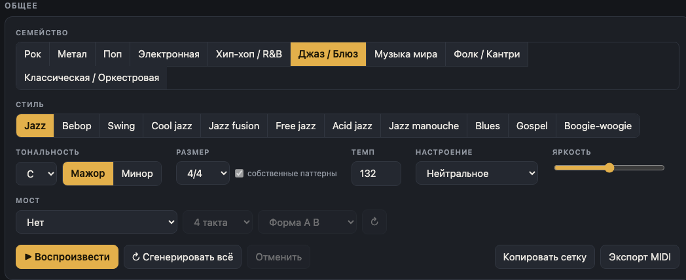
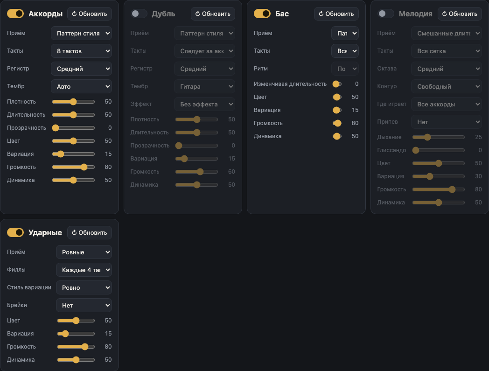
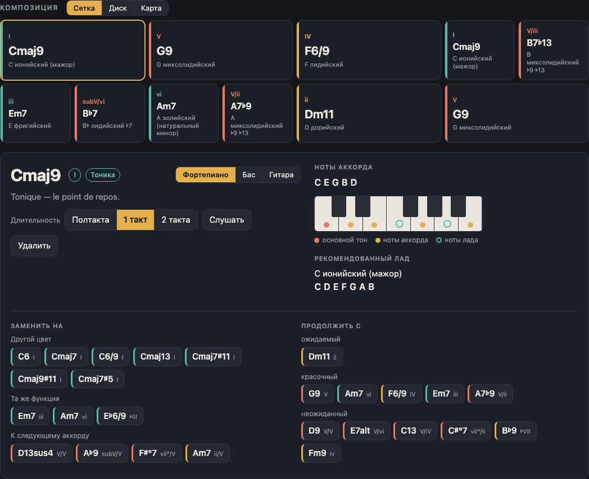
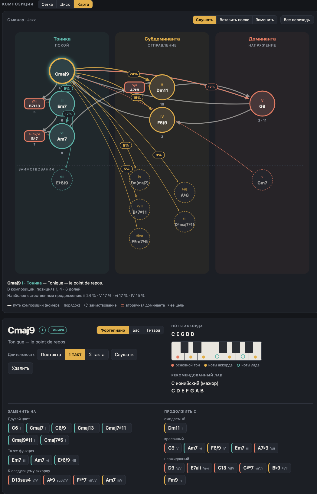
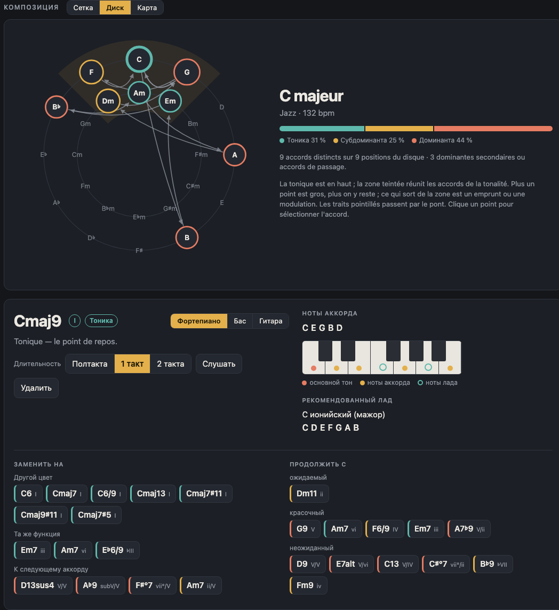
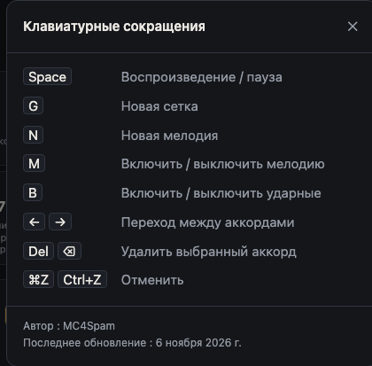
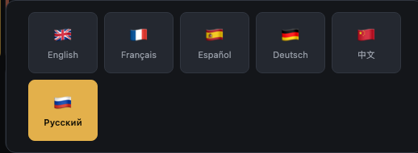

# Harmonie: руководство пользователя

Harmonie генерирует аккордовые последовательности и лады с баса, мелодией и ударными для сочинения во многих стилях. Всё работает в браузере, без установки.

Чтобы запустить приложение, откройте `index.html` в браузере или поднимите папку проекта (например, `python3 -m http.server 8080`) и откройте `http://localhost:8080`.

Настройки и текущая сетка сохраняются в браузере каждого компьютера.

## Общий вид

Экран состоит из трёх частей:

1. **Общее**: настройки, определяющие композицию (семейство, стиль, тональность, размер, темп, настроение, яркость, мост), и кнопки управления воспроизведением.
2. **Инструменты**: панель на каждую партию (Аккорды, Дубль, Бас, Мелодия, Ударные).
3. **Композиция**: сетка аккордов с видами Сетка, Диск и Карта.

В правом верхнем углу кнопка «i» открывает горячие клавиши, а флажок открывает выбор языка. Переключатель **Классическое / Студия** меняет оформление; по умолчанию включено «Классическое».

## Зона «Общее»

| Настройка | Назначение |
|---|---|
| **Семейство** | Группирует стили по большим семействам (Рок, Метал, Поп, Электронная, Хип-хоп / R&B, Джаз / Блюз, Музыка мира, Фолк / Кантри, Классическая / Оркестровая). |
| **Стиль** | Выбирает стиль внутри семейства. У каждого стиля свой гармонический словарь, аккомпанирующий паттерн и набор ударных. Выбор стиля создаёт новую сетку. |
| **Тональность** | Основной звук (от C до B, с бемолями и диезами), кнопки **Мажор** и **Минор**. Смена тональности транспонирует сетку без её пересоздания. |
| **Размер** | Ритмическая размерность. Флажок **собственные паттерны** использует, если он есть, ритмический паттерн, специфичный для размера, вместо перераспределения паттерна 4/4. |
| **Темп** | Темп в ударах в минуту (от 50 до 220). |
| **Настроение** | Пресет (по умолчанию «Нейтральное», далее радостное, меланхоличное, эпическое и т. д.). Задаёт лад, темп, яркость и настройки инструментов, затем создаёт новую сетку. Все эти настройки остаются редактируемыми. |
| **Яркость** | Ползунок, делающий гармонию и звучание светлее или темнее. |
| **Мост** | Добавляет контрастный раздел в соседней тональности: нет, на полутон или на тон выше, на малую терцию выше, относительный минор, одноимённый минор, тональность субдоминанты или доминанты. Параметры: длина (4 или 8 тактов) и форма (**A B** или **A A B A**). Кнопка ↻ пересоздаёт только мост. |

Кнопки управления расположены внизу этой зоны:

- **Воспроизвести** запускает или останавливает воспроизведение (клавиша Пробел).
- **Сгенерировать всё** создаёт новую сетку и новую партию для каждого инструмента.
- **Отменить** возвращает на шаг назад (⌘Z или Ctrl+Z).
- **Копировать сетку** помещает сетку в буфер обмена как текст.
- **Экспорт MIDI** скачивает MIDI-файл того, что звучит (см. ниже).

## Инструменты

У каждого инструмента есть своя панель. Все они имеют одинаковые базовые настройки: **↻ Обновить** (пересоздаёт только эту партию), **Плотность** или **Цвет**, **Вариация** (насколько партия меняется от повтора к повтору), **Громкость** и **Динамика**. Наведите курсор на настройку, чтобы увидеть её действие.

### Аккорды

Панель «Аккорды» играет саму сетку.

- **Приём**: способ игры аккордов: блоком, арпеджио вверх, арпеджио вниз, арпеджио вверх-вниз, случайное арпеджио или паттерн стиля.
- **Такты**: длина паттерна (4, 8, 12 или 16 тактов).
- **Регистр**: низкий, средний или высокий.
- **Тембр**: Авто, Пианино, Гитара, Пэд, Щипковый, Орган, Перегруз, Духовые или Синт.
- **Плотность**, **Длительность**, **Прозрачность**: количество нот, их длительность и паузы между ними.

### Дубль

Второй инструмент дублирует аккорды, со своим тембром и эффектом.

- **Следует за аккордами**: определяет, какие такты дублируются. Настройки такие же, как у «Аккордов», плюс **Эффект**: Без эффекта, Сатурация, Тремоло или Фузз.
- Громкость по умолчанию ниже, чем у аккордов.

### Бас

Бас разделяет **выбор нот** (Приём) и **момент, когда они звучат** (Ритм).

- **Приём**: Паттерн стиля, Основной тон, Основной тон и квинта, Основной тон и октава, Арпеджио, Walking bass, Педаль, Рифф, Певучая линия или Случайный.
- **Ритм**: По приёму, целые, половинные, четверти, восьмые, триоли, шестнадцатые, синкопа (3+3+2), качание (доли 1 и 3), опережение, с призрачными нотами, по бочке или изменчивая длительность.
- **Такты**: вся сетка или мотив в 1, 2, 4 или 8 тактов.

### Мелодия

Мелодию можно выключить или включить клавишей M.

- **Приём**: Долгие ноты, Смешанные длительности или Быстрые ноты.
- **Такты**: вся сетка или мотив в 1, 2, 4 или 8 тактов. **↻ Обновить** создаёт новую мелодию (клавиша N).
- **Октава**: от очень низкого (−2) до очень высокого (+2).
- **Контур**: свободный, восходящий или нисходящий.
- **Где играет**: все аккорды, нечётные аккорды, чётные аккорды или только на тонике.
- **Припев**: повторяет один и тот же мотив каждые 2, 4 или 8 тактов.
- **Дыхание**: паузы между фразами. **Глиссандо**: плавные переходы между нотами.

### Ударные

Ударные можно выключить или включить клавишей B.

- **Приём**: Мягкие, Ровные или Энергичные.
- **Филлы**: без филла или филл каждые 2, 4, 8 или 16 тактов.
- **Стиль вариации**: Ровно, Призрачные ноты, Синкопы, С задержкой или Насыщенно.
- **Брейки**: нет, или брейк каждые 4, 8 или 16 тактов.

## Сетка аккордов

Каждый аккорд отображается карточкой с обозначением, ступенью в тональности, функцией и рекомендуемым ладом. Щелчок по аккорду открывает его подробности под сеткой:

- **Длительность**: полтакта, 1 такт или 2 такта.
- **Слушать** играет только этот аккорд. **Удалить** убирает аккорд.
- **Ноты аккорда**: основной тон, ноты аккорда и ноты лада в виде фортепиано, баса или гитары. Для баса и гитары показываются аппликатуры.
- **Рекомендуемый лад**: лад, подходящий к аккорду.
- **Заменить на**: предлагает аккорды той же функции (другой цвет, та же функция, аккорд, ведущий к следующему), отсортированные по эффекту.
- **Продолжить с**: предлагает возможные следующие аккорды, от «ожидаемый» до «неожиданный».

Стрелки ← и → переходят от аккорда к аккорду, Del удаляет выбранный аккорд.

## Виды «Карта» и «Диск»

**Карта** располагает каждый аккорд в соответствии с его гармонической функцией: тоника, субдоминанта, доминанта и т. д. Она позволяет сразу увидеть, где находится последовательность.

**Диск** показывает аккорды на круге квинт, что делает видимыми соседние аккорды и доминанты.

Кнопки **Сетка**, **Диск** или **Карта** над композицией переключают вид. Все три вида показывают одну и ту же композицию.

## Экспорт MIDI и копирование

**Экспорт MIDI** создаёт MIDI-файл, полностью совпадающий с тем, что вы слышите:

- одна дорожка на инструмент (аккорды, дубль, бас, мелодия);
- ударные на канале 10;
- темп, размер и метка для каждого аккорда.

**Копировать сетку** помещает сетку в буфер обмена как текст, чтобы вставить её в заметку или сообщение.

## Горячие клавиши

| Клавиша | Действие |
|---|---|
| Пробел | воспроизведение / остановка |
| G | новая сетка |
| N | новая мелодия |
| M | мелодия вкл. / выкл. |
| B | ударные вкл. / выкл. |
| ← → | предыдущий / следующий аккорд |
| Del или ⌫ | удалить выбранный аккорд |
| ⌘Z / Ctrl+Z | отменить |

## Язык

Флажок в правом верхнем углу открывает выбор языка. Harmonie доступна на шести языках: English, Français, Español, Deutsch, 中文 и Русский. Выбор сохраняется в браузере.
