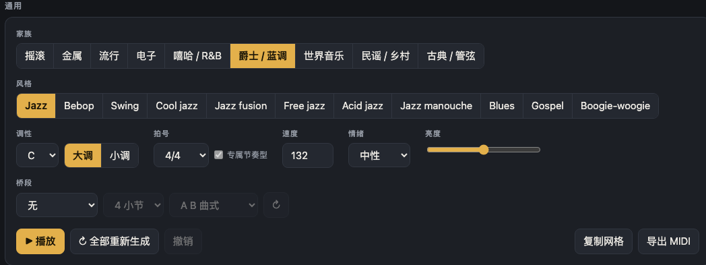
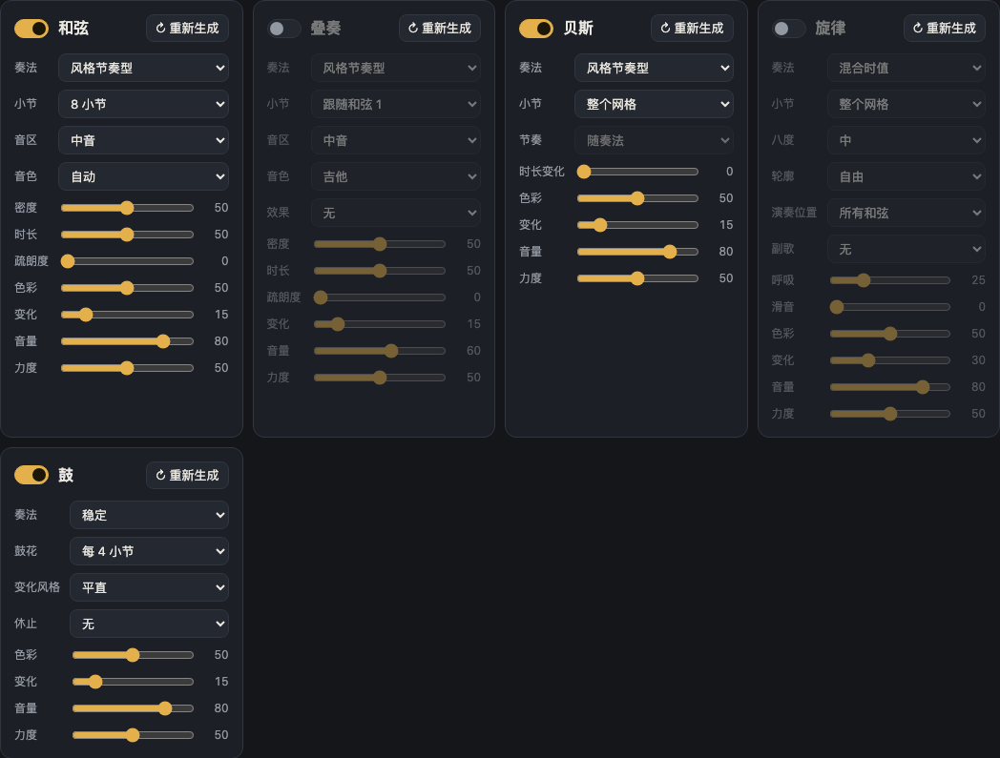
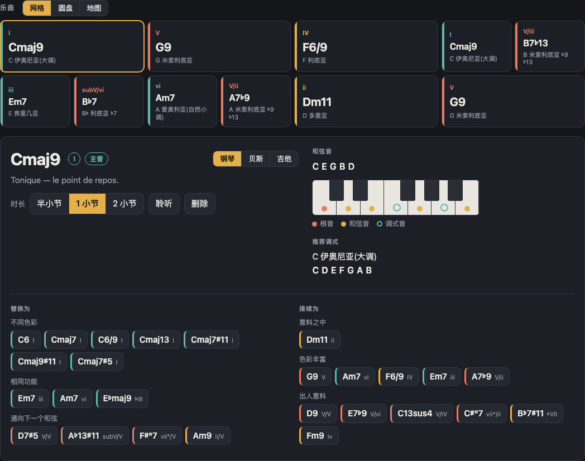
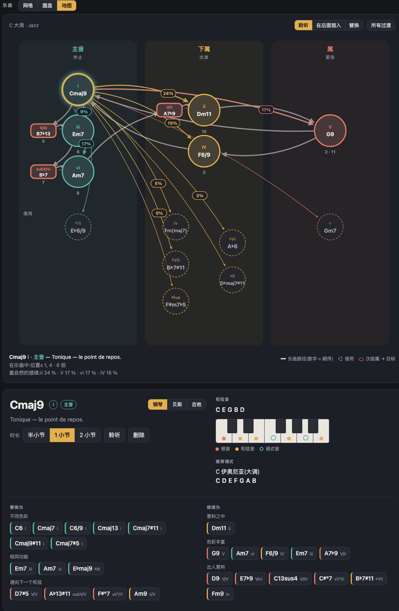
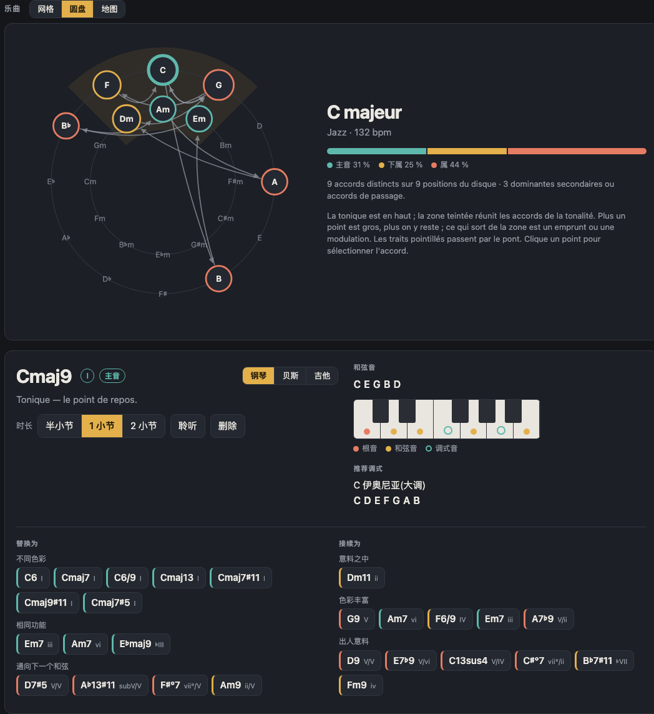
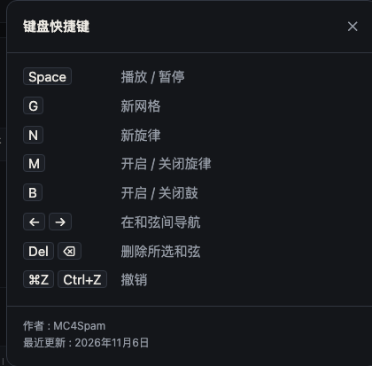
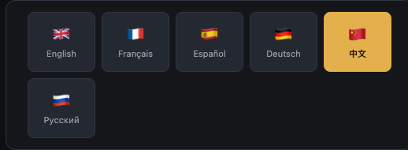

# Harmonie：使用指南

Harmonie 可以生成和弦进行与调式，并配有贝斯、旋律和鼓，适用于多种风格的创作。所有功能都在浏览器中运行，无需安装。

启动应用时，可直接在浏览器中打开 `index.html`，或在项目文件夹中启动本地服务（例如 `python3 -m http.server 8080`），然后访问 `http://localhost:8080`。

设置和当前的网格保存在每台机器的浏览器中。

## 总览

界面分为三个部分：

1. **通用**：决定乐曲的设置（家族、风格、调性、拍号、速度、情绪、亮度、桥段）以及播放控制按钮。
2. **乐器**：每个声部一个面板（和弦、叠奏、贝斯、旋律、鼓）。
3. **乐曲**：和弦网格，可切换为网格、圆盘和地图视图。

右上角的「i」按钮打开键盘快捷键，国旗按钮打开语言选择。**经典 / 工作室** 切换器用于更改外观，默认为「经典」。

## 通用区域

| 设置 | 作用 |
|---|---|
| **家族** | 将风格按大类归组（摇滚、金属、流行、电子、嘻哈 / R&B、爵士 / 蓝调、世界音乐、民谣 / 乡村、古典 / 管弦）。 |
| **风格** | 在家族内选择风格。每种风格都有自己的和声词汇、伴奏节奏型和鼓组。选择风格会生成新的网格。 |
| **调性** | 主音（C 至 B，含降号和升号），配有 **大调** 和 **小调** 按钮。更改调性会移调网格，不会重新生成。 |
| **拍号** | 节拍记号。勾选 **专属节奏型** 后，若该拍号存在专属节奏型，则使用它，而不是按 4/4 的节奏型重新分配。 |
| **速度** | 每分钟拍数（50 至 220）。 |
| **情绪** | 预设（默认为「中性」，另有欢乐、忧郁、史诗等）。它会设置调式、速度、亮度和乐器设置，并生成新的网格。所有这些设置之后仍可修改。 |
| **亮度** | 滑块，使和声与声音更明亮或更暗淡。 |
| **桥段** | 在邻近调性中加入对比段落：无、上方半音、上方全音、上方小三度、关系小调、同主音小调、下属调或属调。选项：长度（4 或 8 小节）和曲式（**A B** 或 **A A B A**）。↻ 按钮只重新生成桥段。 |

播放控制按钮位于该区域底部：

- **播放** 开始或停止播放（快捷键：空格）。
- **全部重新生成** 为每个乐器生成新的网格和新的声部。
- **撤销** 回退一步（⌘Z 或 Ctrl+Z）。
- **复制网格** 将网格以文本形式复制到剪贴板。
- **导出 MIDI** 下载当前所听内容的 MIDI 文件（见下文）。

## 乐器

每个乐器都有自己的面板。所有面板共享相同的基本设置：**↻ 重新生成**（只重新生成该声部）、**密度**或**色彩**、**变化**（声部在每次重复之间变化的程度）、**音量**和**力度**。将鼠标悬停在某个设置上即可查看其作用。

### 和弦

和弦面板负责演奏网格本身。

- **奏法**：和弦的演奏方式：柱式、上行琶音、下行琶音、上下行琶音、随机琶音或风格节奏型。
- **小节**：节奏型的长度（4、8、12 或 16 小节）。
- **音区**：低音、中音或高音。
- **音色**：自动、钢琴、吉他、铺底、拨奏、管风琴、失真、铜管或合成器。
- **密度**、**时长**、**疏朗度**：演奏的音符数量、音符时长以及音符之间的间隔。

### 叠奏

第二个乐器对和弦进行叠奏，并拥有自己的音色和效果。

- **跟随和弦**：设定哪些小节被叠奏。其设置与和弦面板相同，另外还有 **效果**：无、饱和、颤音或毛刺失真。
- 默认音量低于和弦声部。

### 贝斯

贝斯将**音符的选择**（奏法）与**音符的发声时机**（节奏）分开。

- **奏法**：风格节奏型、根音、根音与五度、根音与八度、琶音、行走贝斯、持续音、即兴段、歌唱性线条或随机。
- **节奏**：随奏法、全音符、二分音符、四分音符、八分音符、三连音、十六分音符、切分（3+3+2）、抽泵（第 1、3 拍）、预先、含幽灵音、随底鼓或时长变化。
- **小节**：整个网格，或 1、2、4、8 小节的动机。

### 旋律

旋律可以用 M 键静音或恢复。

- **奏法**：长音、混合时值或快音。
- **小节**：整个网格，或 1、2、4、8 小节的动机。**↻ 重新生成** 会创建新的旋律（N 键）。
- **八度**：从非常低（−2）到非常高（+2）。
- **轮廓**：自由、上行或下行。
- **演奏位置**：所有和弦、奇数和弦、偶数和弦，或仅在主和弦。
- **副歌**：每 2、4 或 8 小节重复同一动机。
- **呼吸**：乐句之间的停顿。**滑音**：音符之间的滑动连接。

### 鼓

鼓可以用 B 键静音或恢复。

- **奏法**：柔和、稳定或激昂。
- **鼓花**：无鼓花，或每 2、4、8 或 16 小节一个鼓花。
- **变化风格**：平直、鬼音、切分、延后或密集。
- **休止**：无，或每 4、8 或 16 小节一次休止。

## 和弦网格

每个和弦以卡片形式显示，包括和弦符号、在调中的级数、功能和推荐调式。点击某个和弦会在网格下方打开其详情：

- **时长**：半小节、1 小节或 2 小节。
- **聆听** 单独播放该和弦。**删除** 移除该和弦。
- **和弦音**：主音、和弦音和调式音，以钢琴、贝斯或吉他视图显示。贝斯和吉他会显示指法。
- **推荐调式**：与该和弦相配的调式。
- **替换为**：提议功能相同的和弦（不同色彩、相同功能、引向下一个和弦的和弦），按效果排序。
- **接续为**：提议可能的后续和弦，从「意料之中」到「出人意料」。

← 和 → 箭头在和弦之间移动，Del 删除所选和弦。

## 地图和圆盘视图

**地图** 按各和弦的和声功能放置它们：主音、下属、属等。一目了然地显示进行的位置。

**圆盘** 将和弦显示在五度圈上，使相邻和弦和属和弦一目了然。

乐曲上方的 **网格**、**圆盘** 或 **地图** 按钮可切换视图。三种视图显示的是同一首乐曲。

## MIDI 导出和复制

**导出 MIDI** 生成与所听内容完全一致的 MIDI 文件：

- 每个乐器一条轨道（和弦、叠奏、贝斯、旋律）；
- 鼓位于第 10 通道；
- 包含速度、拍号以及每个和弦的标记。

**复制网格** 将网格以文本形式复制到剪贴板，方便粘贴到笔记或消息中。

## 键盘快捷键

| 按键 | 操作 |
|---|---|
| 空格 | 播放 / 停止 |
| G | 新网格 |
| N | 新旋律 |
| M | 旋律开 / 关 |
| B | 鼓开 / 关 |
| ← → | 上一个 / 下一个和弦 |
| Del 或 ⌫ | 删除所选和弦 |
| ⌘Z / Ctrl+Z | 撤销 |

## 语言

右上角的国旗打开语言选择。Harmonie 提供六种语言：English、Français、Español、Deutsch、中文和 Русский。选择会保存在浏览器中。
